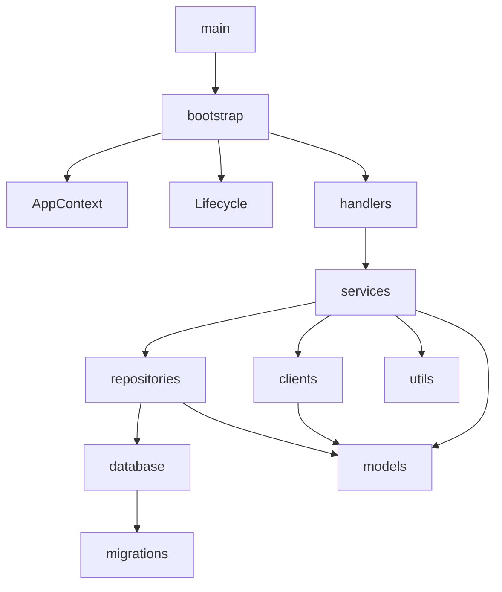

# 模块维护与依赖说明

本文档说明当前代码结构，后续重构可同步更新，不应将历史实现方式视为不可修改的要求。

## 目录树

```text
cxbot/
├── docs/
│   ├── DEPLOYMENT.md
│   ├── LOGIN.md
│   ├── MODULES.md
│   ├── legacy_inventory.json
│   ├── migration_map.json
│   ├── release_audit.json
│   ├── release_manifest.json
│   └── test-results.xml
├── scripts/
│   ├── audit_release.py
│   ├── check_environment.py
│   ├── deliver_saved.py
│   ├── migrate_database.py
│   ├── review_tasks.py
│   └── snapshot_database.py
├── telegram_bot/
│   ├── clients/
│   │   ├── __init__.py
│   │   ├── bot_application.py
│   │   ├── dialogue.py
│   │   ├── request_tracker.py
│   │   ├── session_store.py
│   │   └── userbot_manager.py
│   ├── handlers/
│   │   ├── __init__.py
│   │   ├── balance.py
│   │   ├── checkin.py
│   │   ├── guards.py
│   │   ├── jr_query.py
│   │   ├── login.py
│   │   ├── registration.py
│   │   ├── start_help.py
│   │   └── status.py
│   ├── models/
│   │   ├── __init__.py
│   │   ├── account.py
│   │   ├── enums.py
│   │   └── query.py
│   ├── services/
│   │   ├── jr/
│   │   │   ├── __init__.py
│   │   │   ├── account_selector.py
│   │   │   ├── cache_service.py
│   │   │   ├── export_service.py
│   │   │   ├── membership_service.py
│   │   │   ├── ocr_service.py
│   │   │   ├── orchestrator.py
│   │   │   ├── pagination.py
│   │   │   ├── result_parser.py
│   │   │   └── target_client.py
│   │   ├── __init__.py
│   │   ├── account_status_service.py
│   │   ├── balance_service.py
│   │   ├── checkin_service.py
│   │   └── login_service.py
│   ├── storage/
│   │   ├── repositories/
│   │   │   ├── __init__.py
│   │   │   ├── account_repository.py
│   │   │   ├── cache_repository.py
│   │   │   ├── checkin_repository.py
│   │   │   ├── membership_repository.py
│   │   │   ├── query_repository.py
│   │   │   └── user_repository.py
│   │   ├── __init__.py
│   │   ├── database.py
│   │   ├── migrations.py
│   │   └── sql.py
│   ├── utils/
│   │   ├── __init__.py
│   │   ├── keyed_locks.py
│   │   ├── message_format.py
│   │   ├── paths.py
│   │   ├── process_lock.py
│   │   └── retry.py
│   ├── __init__.py
│   ├── app_context.py
│   ├── bootstrap.py
│   ├── config.py
│   ├── lifecycle.py
│   ├── logging_config.py
│   └── target_bots.py
├── tests/
│   ├── integration/
│   │   ├── test_boundaries.py
│   │   ├── test_jr.py
│   │   └── test_storage.py
│   ├── unit/
│   │   ├── test_accounts_checkin_balance.py
│   │   ├── test_architecture.py
│   │   ├── test_config_format.py
│   │   ├── test_first_chat_menu.py
│   │   ├── test_login.py
│   │   ├── test_pages_export_cache.py
│   │   └── test_routes_ocr_lifecycle.py
│   └── conftest.py
├── .env.example
├── .gitattributes
├── .gitignore
├── README.md
├── main.py
├── pytest.ini
├── requirements-dev.txt
├── requirements-lock.txt
└── requirements.txt
```

## 职责与依赖

| 维护位置 | 职责 | 主要依赖 |
|---|---|---|
| `main.py` | 唯一程序入口 | bootstrap |
| `bootstrap.py` | 配置后显式创建并注入资源、信号和进程锁 | 各层构造器；不实现业务 |
| `config.py` | 环境/私有文件配置、类型与路径校验 | 标准库 |
| `app_context.py` | 冻结的服务引用集合；可变状态由各服务自己拥有 | 服务和资源类型 |
| `lifecycle.py` | 后台任务收割、在途请求等待/取消、逆序关闭 | AppContext 接口 |
| `logging_config.py` | 20 MB 轮转及凭据/异常日志脱敏 | Config |
| `clients/userbot_manager.py` | 唯一 Telethon 客户端所有者、锁、授权、重连、FloodWait | models、AccountRepository、retry |
| `clients/bot_application.py` | PTB 构建和部分初始化后的逐项关闭 | handlers 的菜单接入 |
| `clients/dialogue.py` | 有界只读轮询、新消息和编辑关联、按钮定位 | retry |
| `clients/request_tracker.py` | 命令在途请求生命周期 | asyncio |
| `services/checkin_service.py` | 按账号/目标调度、成功确认、最小间隔 | manager、dialogue、CheckinRepository |
| `services/balance_service.py` | 三个目标查询和余额结果分类 | manager、dialogue、target_bots |
| `services/account_status_service.py` | 实时连接/授权状态汇总 | manager |
| `services/jr/orchestrator.py` | 查询账本与选号、购买、导出、分页和交付的编排 | 注入的 JR 服务、QueryRepository |
| `services/jr/account_selector.py` | 实时积分降序、日限额与未核实账号过滤、全 JR FloodWait 暂停 | BalanceService、MembershipService、QueryRepository |
| `services/jr/target_client.py` | 一次提交/按钮点击及结果轮询 | dialogue、target_bots |
| `services/jr/result_parser.py` | 纯函数识别结果/失败/验证、购买/分页按钮、页码及展示整理 | target_bots、dialogue 的纯函数 |
| `services/jr/pagination.py` | 200 页、重复/未前进/总页数变化检测 | TargetClient、result_parser |
| `services/jr/export_service.py` | 单次导出、消息关联、安全下载、交付意图与进度、管理员通知 | CacheService、QueryRepository、Bot API |
| `services/jr/ocr_service.py` | 离线图片识别、原预处理和概率兼容、单线程与超时/置信度 | Pillow、ddddocr、models、target_bots |
| `services/jr/cache_service.py` | 缓存键、读取一致性和根目录内安全清理，共享文件互斥 | CacheRepository、paths |
| `services/jr/membership_service.py` | 会员及北京时间每日资格判断 | MembershipRepository、target_bots |
| `storage/database.py` | 连接、WAL、busy_timeout、FULL 同步、事务/取消回滚、一致备份 | aiosqlite、migrations |
| `storage/migrations.py` | 严格结构检查、旧表转换和版本 1 | sql、target_bots 中固定目标键 |
| `storage/sql.py` | 事务内取单行并关闭游标 | 无业务依赖 |
| `storage/repositories/` | 独占具体 SQL：签到/查询/缓存/会员用量/封禁/冷却 | Database、sql、models |
| `models/` | 账号、操作/查询结果及显式枚举 | 标准库；不依赖客户端/服务 |
| `utils/` | 转义分段、路径限制、只读重试、键锁、进程锁 | 标准库；不反向依赖业务 |
| `handlers/` | 解析参数、统一权限保护、调用服务、回复 | 服务接口；不写 SQL 或 OCR/分页逻辑 |
| `scripts/` | 离线环境诊断/快照/迁移/人工核实；显式保存结果交付 | 公开服务及 Repository 接口 |

## 允许的依赖方向



底层 models/utils/storage 不得导入 handlers/services；handlers 不直接持有 SQL；JR 编排通过构造器注入接口。`database → migrations → sql` 没有返回 database 的导入。导入和 AST 依赖图自动测试确保无环。

结构调整：增加 dialogue 统一只读轮询、request_tracker 跟踪所有命令关闭、sql 消除数据库与迁移互相导入、AccountRepository 持久冷却、CacheRepository 管理文件引用。这些职责在原建议结构中未单列，独立后避免将 SQL、生命周期状态或通信逻辑重复散入业务文件。

handlers 的文件短是因为只承担传输层职责；没有 utils.py 或 services.py 杂物模块。当前最长 OCR 约 250 行，保留原图像处理算法以方便比对；全部业务文件均低于 400 行。

## 修改入口

- 目标机器人规则：target_bots.py；部署路径/并发/超时：config.py + .env.example。
- 签到业务：checkin_service + CheckinRepository；相关测试 accounts_checkin_balance。
- OCR：ocr_service；当前第三方安全验证转人工处理，是否变更须检查实际服务与安全边界；相关测试 routes_ocr_lifecycle。
- JR 行为：orchestrator 与对应单职责服务；状态枚举在 models/enums.py，账本 SQL 在 QueryRepository。
- 数据库变化：migrations 增加新版本、严格校验与备份测试，禁止更改旧版本来覆盖已有生产库。
- 命令：registration.COMMANDS 与 callbacks 一起维护，帮助/菜单使用同一清单，权限使用 protected。
- 测试命令见根目录 README；旧定义映射数据保留于 `docs/migration_map.json`，相关测试依赖它。

## 资源和恢复边界

服务实例管理自己的锁和状态；AppContext 只保存显式依赖。SQLite 事务串行化业务写入，操作系统数据库锁阻止同一数据库多进程，不能检测使用不同数据库的其他程序共享同一 Session，部署时必须停止旧进程。

重启可恢复签到 next_at、last_attempt/last_success、会员用量、封禁、缓存、冷却、查询阶段/消息 ID、额度预留、交付进度。不能从一次网络超时判断第三方是否收费，也不能证明 Bot API 发送是否已交付，需人工核实。OCR 原生线程不可强行杀死；等待超时后禁止追加识别任务，正常线程退出后可以继续，永久卡死需要运维重启进程。

## 登录与菜单相关模块

- handlers/login.py：私聊登录命令、输入删除和安全回复；依赖 LoginService。
- services/login_service.py：手机号/验证码/两步验证状态机、期限、取消和限流；依赖 UserbotManager，不接触数据库或日志内容。
- clients/session_store.py：授权密钥保存、600 权限和原子不覆盖发布；依赖 Telethon SQLiteSession。
- UserbotManager：唯一创建客户端的位置；新登录完成后重新连接检查授权并接入账号字典。
- Lifecycle 注册登录过期清理并在退出时关闭未完成登录；成功回调增量创建三个目标的签到任务，start 自身防重复。

- handlers/menu_sync.py：集中管理员菜单注册，对尚未建立的私聊延后注册；registration 和 start_help 共同调用，不产生反向导入。
